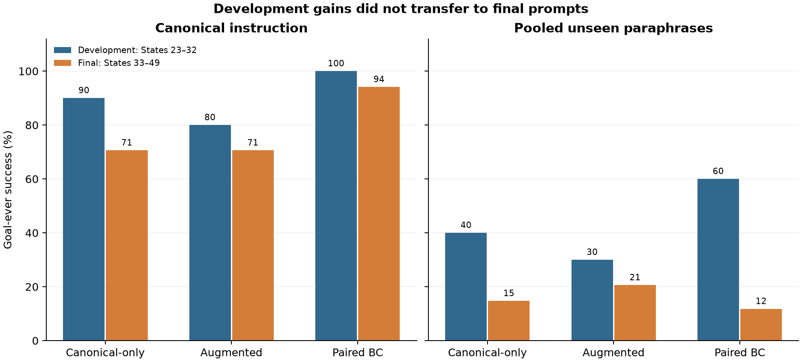
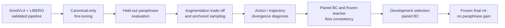
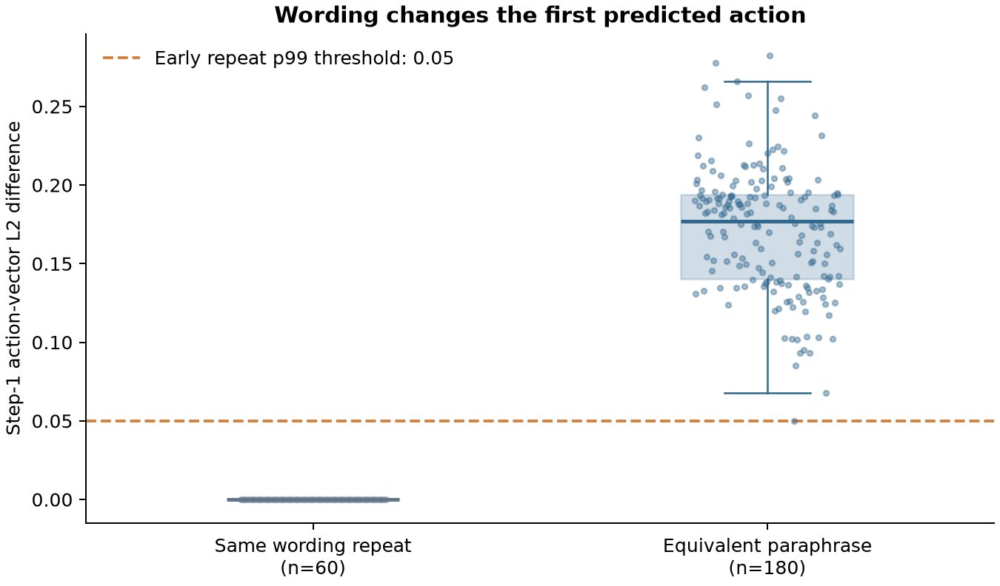
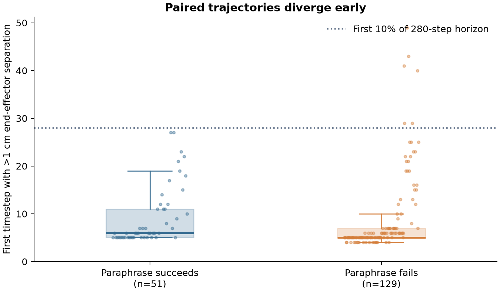

# SmolVLA Language Robustness on LIBERO

**Status: experimental pipeline complete.** This project adapts and evaluates SmolVLA on one LIBERO-Spatial manipulation task to study what happens when the *same* task is phrased differently. Paired language training looked promising on development prompts, but **did not improve unseen-paraphrase success in the frozen final evaluation**.

[Experiment history](docs/experiments.md) · [Method](docs/method.md) · [Full results](docs/results.md) · [Setup](docs/setup.md) · [Reproduction notes](docs/reproduction.md)

## At a glance

| Final v4, Task 0, States 33–49 | Canonical instruction | Two new paraphrases, pooled | Balanced score H |
| --- | ---: | ---: | ---: |
| Canonical-only fine-tuning (`original_language`) | 12/17 · 70.6% | 5/34 · 14.7% | 0.2434 |
| Language augmentation (`augmented_language`) | 12/17 · 70.6% | 7/34 · 20.6% | 0.3188 |
| Paired language training (`paired_bc`) | **16/17 · 94.1%** | 4/34 · 11.8% | 0.2092 |

The registered paired differences for pooled paraphrase success were −2.9 percentage points versus canonical-only (95% CI −14.7 to +8.8) and −8.8 points versus augmentation (95% CI −20.6 to +2.9). Both intervals include zero. The final result is a **negative robustness result**, with higher observed canonical success for `paired_bc`. See [all counts, intervals and protocol amendments](docs/results.md).



*Development and final prompts and states differ; this is a descriptive comparison, not a paired estimate of a common test set. Figure generated from [frozen summaries](results/).*

## Motivation and research question

Two instructions can describe exactly the same robot task, yet a vision-language-action policy can predict different actions solely because the wording changes. We ask: **How sensitive is SmolVLA's behavior to semantically equivalent task instructions, and can simple language-training interventions improve robustness without losing canonical task performance?**

The concrete task is to pick up the black bowl between the plate and the ramekin and place it on the plate. This is a focused, single-task study, not a LIBERO-wide robustness benchmark.

## Project overview



This progression matters: the intervention was motivated by a measured action-level failure mode, selected on development data, and then checked against newly frozen final language conditions. [Why each stage happened](docs/experiments.md).

## Experimental setup

- **Policy and simulator:** official SmolVLA LIBERO checkpoint and LeRobot observation/action pipeline in LIBERO-Spatial Task 0. The project adapts the action expert and projection parameters; it does not change SmolVLA's architecture.
- **Training data:** 36 exact-task official demonstrations for training, with 9 held out in the earlier data audit. The paired arms start from the same frozen `original_language` step-1000 checkpoint and receive 1,000 additional matched updates.
- **Evaluation:** 280-step rollouts, one worker, environment and policy seeds 0, primary metric `goal_ever` (the goal becomes true at least once). `goal_final` is secondary.
- **Isolation:** initial exploratory States 0–2; first confirmatory States 3–22; model-selection States 23–32; final v4 States **33–49**. The installed official Task-0 initial-state asset has only 50 rows (indices 0–49); the originally planned 50–52 were invalid and removed before final outcomes were inspected. Training, development, earlier held-out, and final instruction catalogs are separate.

The final matrix contains 3 models × 17 states × 3 prompts = **153 valid rollouts**. Its [frozen matrix](configs/final_confirmatory/final_matrix_v4.json), [model manifest](configs/final_confirmatory/frozen_model_manifest_v4.json), and [v4 freeze record](configs/final_confirmatory/freeze_final_protocol_v4.json) document the exact protocol and hashes.

## What goes wrong under paraphrases?

Matched rollout diagnostics compare the same initial physical state under canonical and paraphrased text. The identical-instruction repeat control had **zero Step-1 action difference**; paraphrase pairs had about **0.17 mean Step-1 action-vector L2 difference**. All 180 paraphrase pairs crossed the empirical action threshold at Step 1. End-effector paths typically exceeded 1 cm separation around Steps 5–6. Failed paraphrase episodes had larger average action divergence during the first 10% of the rollout than successful paraphrase episodes (0.294 versus 0.218 in this diagnostic set).

These observations locate wording sensitivity in the predicted action field before substantial closed-loop interaction. Later trajectories often separate further; they do not, by themselves, prove that action divergence is the sole cause of failure. [Diagnostic methods and source data](docs/results.md#action-and-trajectory-diagnostics).





## Methods evaluated

| Arm | Purpose |
| --- | --- |
| `original_language` | Canonical-only fine-tuning baseline. |
| `augmented_language` | Baseline using four training paraphrases alongside the canonical instruction. |
| `anchored_language` | Sampling ablation: 50% canonical, 12.5% for each training paraphrase. Failed its development gate. |
| `paired_bc` | Data/update-matched control: the same physical sample, action target, flow noise and time under canonical and one paraphrased instruction. Selected on development data. |
| `paired_flow_consistency` | Same paired controls plus a frozen canonical teacher's velocity-field consistency loss. Failed to beat `paired_bc` on development data and was not advanced to final evaluation. |

[Losses, controlled inputs and schedule](docs/method.md).

## Development versus final

On States 23–32, `paired_bc` achieved canonical **10/10**, pooled development paraphrases **12/20**, and H = **0.7500**. `paired_flow_consistency` achieved 9/10, 11/20, H = 0.6828; its pre-registered selection gate failed. The earlier `original_language`, `augmented_language`, and `anchored_language` development H scores were 0.5538, 0.4364 and 0.4421.

On final States 33–49 with two *new* frozen paraphrases, `paired_bc` retained high canonical success but reached only **4/34 (11.8%)** pooled paraphrase success, below both baselines' observed rates. Development gains did not generalize to these final prompts. [Complete tables and 95% paired state-bootstrap intervals](docs/results.md).

## Key takeaways

1. Semantically equivalent instructions can produce different first actions and large closed-loop trajectory differences in this SmolVLA task.
2. Uniform language augmentation improved unseen-paraphrase success in the *first* confirmatory experiment while reducing canonical success; changing the sampling ratio did not solve that trade-off on development data.
3. Strong development performance did not predict final unseen-language robustness for paired training. Strict state and prompt separation changed the scientific conclusion.

## Reproducibility and repository map

Experiment journals use `complete.json` as the committed-rollout marker; incomplete attempts remain available for audit and are not counted. Frozen protocols record model, prompt, source/config, checkpoint and state-asset hashes. The final report uses 10,000 paired bootstrap resamples of 17 state clusters, preserving all model/prompt outcomes for each sampled state. [Curated result JSON/CSV](results/) are checked-in copies of completed local outputs; raw checkpoints, videos and execution logs stay under ignored `outputs/`.

```text
configs/                    Frozen training and evaluation catalogs/matrices
src/smolvla_grounding/      Policy adapters, records, evaluators and statistics
scripts/                    Staged training, evaluation and diagnostic entry points
tests/                      Protocol, pairing, checkpoint and evaluator checks
results/                    Small curated result tables and diagnostic data
assets/figures/             Plots generated from those curated results
docs/                       Experiment history, method, results and setup
outputs/                    Local raw runs, videos, checkpoints and logs (Git-ignored)
```

### Verified entry points

From the repository root in the configured Linux/WSL2 environment, after the prerequisites in [setup](docs/setup.md) and [reproduction notes](docs/reproduction.md):

```bash
python scripts/run_paired_training.py
python scripts/run_paired_development_evaluation.py
python scripts/diagnose_language_divergence.py
python scripts/make_portfolio_figures.py
```

The historical confirmatory entry points are `scripts/run_held_out_evaluation.py` and `scripts/run_final_confirmatory_evaluation.py`. They use frozen matrices and existing committed-run resume rules; **do not rerun consumed test states to explore a new method**. Training and rollout stages can take many hours and depend on local checkpoints/data that are not in Git. The workflow has run in this project environment, but a clean-clone end-to-end reproduction on another machine has not been verified.

## Scope and attribution

This is one task and a small set of instruction paraphrases. The final effect intervals include zero, and the plots describe associations in observed trajectories rather than a proven causal mechanism. SmolVLA, LeRobot, LIBERO and simulator assets are upstream work; see [attribution and license scope](THIRD_PARTY.md). Project-specific code and documentation are [MIT-licensed](LICENSE).

## Multi-task canonical competence screen

Before the development language pilot, the untuned official SmolVLA checkpoint was screened on six additional LIBERO tasks using canonical instructions and initial states 0–4. Five tasks reached the predeclared 3/5 competence threshold: spatial/1 (3/5), spatial/4 (5/5), object/0 (5/5), goal/5 (5/5), and goal/7 (5/5). Goal/0 (2/5) was excluded. These 30 canonical rollouts select feasible pilot tasks; they are not evidence of language robustness. The compact [screening summary](results/multitask_canonical_screen/summary.json) and [frozen matrix](configs/multitask_evaluation/canonical_screen_matrix.json) are public; raw trajectories and videos remain local under `outputs/multitask_evaluation/`.
