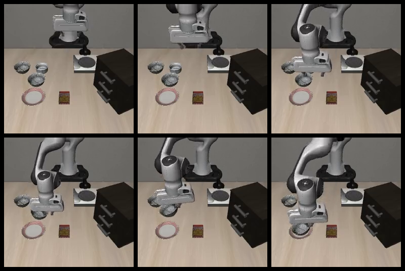

# Robust Language Grounding and Adaptation for SmolVLA on LIBERO

**Does the same robot task still succeed when its instruction is rephrased?**
This project evaluates language robustness of the official LIBERO-adapted SmolVLA
policy and compares original-language versus language-augmented fine-tuning on
an **RTX 4070 Laptop GPU (8 GB)**.

**Status: v0.1 research prototype prepared for publication.** Evaluation, data
preparation and three controlled development training/evaluation rounds have run.
The latest results show a gain on one paraphrase; another still fails. Current
scope is one LIBERO Spatial task and three development initial states.

[Results](results/README.md) · [Setup](docs/setup.md) ·
[Reproduction](docs/reproduction.md) · [Documentation](docs/README.md) ·
[Contributing](CONTRIBUTING.md)


*Official pretrained-policy integration check. These frames show the first rollout,
not the later fine-tuning comparison. [Episode evidence](results/first_rollout/README.md).*

## Motivation

A robot instruction can have many equivalent wordings. A useful policy should
retain task success across those wordings and respond appropriately when the
requested object or spatial relation actually changes. We study these separately:
paraphrase robustness does not by itself establish correct semantic grounding.

## Method

1. Use the official pretrained SmolVLA LIBERO checkpoint and LeRobot/LIBERO environment.
2. Pair language conditions by task, initial simulator state and policy seed; verify
   reset observations and include an identical-instruction repeat control.
3. Save fixed-horizon rollouts, goal timelines, actions, videos and CSV/JSON records.
4. Select 45 exact-task official demonstrations: 36 for training, 9 held out.
5. Compare the untuned policy with two matched fine-tuning arms:
   **original-language** uses only the original wording; **language-augmented** uses
   the original plus four meaning-preserving variants. Both receive the same
   demonstration frames, update budget and controlled randomness.

The original-language arm measures what extra task training achieves by itself.
The augmented arm tests the additional effect of varied wording. Evaluation
paraphrases B/C are excluded from the training catalog, but have been used for
hyperparameter development; they are not an untouched test set.

Training freezes the vision-language backbone and updates the action expert and
projection parameters. Batch size is 1, with BF16 autocast and FP32 trainable
parameters. Measured peak PyTorch reserved memory was about **3.14 GiB**; this is
not total-device memory. This is expert fine-tuning, not LoRA or full-model training.

## Latest development results

LIBERO Spatial task 0; initial states 0/1/2; policy seed 0; 280-step fixed horizon.
Each cell is **successful episodes / 3**, not a full-suite success rate.

| Model | Original A | Paraphrase B | Paraphrase C |
| --- | --- | --- | --- |
| Untuned precision-matched baseline (reused) | 1/3 | 0/3 | 0/3 |
| Original-language fine-tuning, 1000 updates | 3/3 | 0/3 | 0/3 |
| Language-augmented fine-tuning, 1000 updates | 2/3 | 0/3 | 2/3 |

Both fine-tuned models use a peak learning rate of `1e-5`. Goal-ever and final-step
counts agree in this round. The original-language model's identical-A repeat
succeeded in 2/3 rather than 3/3, showing outcome variability. The augmented model
improves C but still fails B and has fewer A successes than the control.

[Full comparison and caveats](results/longer_training_development/README.md) ·
[CSV](results/longer_training_development/summary.csv) ·
[JSON](results/longer_training_development/summary.json)

<details>
<summary>Exact evaluation wordings</summary>

- **A (official task instruction):** pick up the black bowl between the plate and the ramekin and place it on the plate
- **B:** lift the black bowl located between the plate and the ramekin, then put it onto the plate
- **C:** place onto the plate the black bowl that is between the plate and the ramekin

See the [evaluation catalog](configs/instructions/task0.jsonl) and
[training catalog](configs/instructions/task0_train.jsonl).

</details>

Earlier rounds, repeat diagnostics and qualitative failures are retained in the
[results index](results/README.md), including unsuccessful comparisons.

## Setup and first rollout

Use Linux/WSL2 with an NVIDIA CUDA GPU and Python 3.12. Install native build tools
and uv following [setup](docs/setup.md), then run each command after the preceding
stage passes:

```bash
bash scripts/setup_environment.sh
source .venv/bin/activate
python scripts/download_checkpoint.py
python scripts/check_policy.py
bash scripts/run_first_rollout.sh
python scripts/summarize_first_rollout.py
```

The official policy is `HuggingFaceVLA/smolvla_libero`, pinned to revision
`6721902bc4d61e50a3bfdb11dfb4cb626f05d102`. Dependencies and other revisions are
recorded in [requirements](requirements.txt), [environment versions](docs/environment-packages.txt)
and `configs/`. The first rollout saves an MP4 and evaluator logs under
`outputs/first_rollout/`; its summary exporter writes small public artifacts.

## Experiments and repository layout

The [reproduction guide](docs/reproduction.md) lists all benchmark, training and
evaluation commands and their required preceding artifacts. Full training uses
staged scripts with interactive budgets and resume checks. Some configurations
reference the original study's local report names and must be updated for a new
study; clean-clone end-to-end training has not yet been independently verified.

```text
configs/                 Pinned revisions, instructions and experiment settings
src/smolvla_grounding/    Protocol, data checks, records and experiment utilities
scripts/                 Setup, evaluation, training and export entry points
tests/                   CPU protocol and record-validation tests
docs/                    Setup, methods, audits and reproduction instructions
results/                 Curated CSV/JSON, keyframes and written analyses
```

Local environments, downloads, weights and raw run artifacts are ignored by Git.
Selected keyframes are included; raw MP4s are currently local, with public video
attachments planned for a release. [CPU check instructions](CONTRIBUTING.md).

## Upstream and project contributions

**Upstream:** LeRobot supplies the SmolVLA policy, processors, training utilities and
evaluator; LIBERO supplies tasks, assets, instructions and goal predicates;
MuJoCo/robosuite supply simulation. The starting checkpoint and demonstrations
are official Hugging Face releases.

**This project:** controlled language catalogs and initial-state pairing, repeat
and replay diagnostics, demonstration selection/mapping checks, matched two-arm
fine-tuning orchestration, resumable provenance records, and quantitative/qualitative
analysis. A small loading adapter preserves FP32 trainable weights on reload; the
policy architecture, forward pass, loss and sampler remain upstream.

See [upstream attribution and license scope](THIRD_PARTY.md). This project is not
affiliated with Hugging Face or the LIBERO authors.

## Limitations

- One task, three initial states and one policy seed; these are development cases.
- Reused baselines provide no additional independent observations. Repeated original
  instructions can produce different outcomes despite controlled resets and seeds.
- Fixed-horizon goal metrics differ from standard benchmark evaluation conventions.
- Changed-object/relation scoring is provisional pending positive-case validation;
  no semantic-sensitivity improvement is established.
- Latest C successes still need video review. Existing failure reviews cover selected
  earlier rollouts, not every episode or a demonstrated causal explanation.
- No general robustness, statistical significance or causal overfitting claim follows
  from these results. Dependency pins are not a complete portable environment lock.

## Next milestones

- [ ] Review latest C successes and the identical-A disagreement.
- [ ] Freeze the candidate configuration; evaluate new states and new paraphrases.
- [ ] Validate alternative-goal predicates before reporting semantic-change scores.
- [ ] Export comparison plots and selected public rollout videos.
- [ ] Verify the full workflow from a clean clone and simplify artifact references.
- [ ] Extend beyond task 0 after the small experiment is validated.

## License

Project-specific code and documentation: [MIT](LICENSE).
Upstream software, models, data and scene assets retain their own terms; see
[THIRD_PARTY.md](THIRD_PARTY.md).
