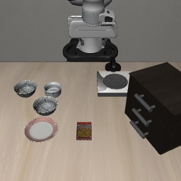

# Task-0 controlled language pilot

Status: all six reset checks passed on 2026-09-08. The saved report and artifacts were
verified against their hashes, and the initial main-camera scene was inspected.
All six paired-policy episodes have now completed and their saved evidence was audited.
Both originals succeed; the other four trials do not achieve their requested goals.
Repeated-original trajectories diverge at step 46; see the
[measured results and open controls](../results/language_pilot/README.md). The existing
successful first rollout is a separate integration result, not a sample from this protocol.

Evidence: [reset-validation report](pairing_validation.json). The check took 633.92 s,
including cold imports and six fresh environment resets. Token counts were 20, 20,
21, 18, 19 and 13 out of a maximum of 48. All captured reset arrays and both camera
images matched exactly. This establishes reset pairing, not policy determinism.



The initial view contains two bowls, a ramekin and the plate. Object IDs are grounded
in the official BDDL initialization regions; visual inspection alone does not prove
that a language model interprets the alternate referent correctly.

## Fixed comparison

Use `libero_spatial` task 0, initial-state index 0, environment seed 0 and policy seed 0.
The [configuration](../configs/language_pilot.json) and
[exact English instructions](../configs/instructions/task0.jsonl) are versioned.
The user approved the meanings of the contrasts. English variants were authored by
the project assistant; independent linguistic or rendered-scene review is not claimed.

| Condition | Trials | Requested source object | Role |
| --- | ---: | --- | --- |
| Original | 1 | Black bowl between plate and ramekin | Baseline |
| Original repeat | 1 | Same black bowl | Check trajectory nondeterminism |
| Paraphrase | 2 | Same black bowl | Preserve meaning, change wording/syntax |
| Changed relation | 1 | Other black bowl next to ramekin | Change source referent |
| Changed object | 1 | Ramekin | Change object category |

Every destination is `plate_1`. The repeated-original trial is a diagnostic control,
excluded from the main original-condition denominator. These six trials share one
task/state/seed; they are not six independent samples of general performance.
The phrase "other black bowl next to the ramekin" needs standalone ambiguity review:
"other" helps express the contrast, but its referent is contextual, and proximity alone
may describe both bowls. Do not hide this limitation when reporting the pilot.

## Gate B1: tokens, predicates and initial states

Run this in the existing WSL terminal:

```bash
# Run from the repository root.
source .venv/bin/activate
python scripts/check_language_pairing.py
```

This sets the already validated EGL renderer, reuses the downloaded tokenizer and
records its immutable cached revision. It does not load policy weights. Cold imports
and six fresh renderer resets can take several minutes on the Windows-mounted
environment; startup and per-condition progress are printed explicitly.

For each instruction, the checker creates the official LeRobot environment, verifies
the official task name and original language, substitutes `task_description`, restores
the same indexed official initial state, and applies the same ten upstream settling
steps. It then checks:

- Tokenization with the checkpoint's newline convention loses no tokens at its
  configured maximum length; distinct variants have distinct token sequences.
- The configured original predicate equals the parsed BDDL goal and agrees with
  native LIBERO success at reset. All three initial goal predicates are false.
- The captured simulator state, additional dynamics/model arrays, robot observation
  and both camera images match the original condition exactly across all six resets.

Artifacts under ignored `outputs/language_pairing/` include `identity.json`,
`tokens.json`, per-condition `initial_state.npz`, main/wrist PNGs, inspection records,
and a timestamped validation report. No successful validation report is committed
before the check has actually run.

Run the same command after an interruption. It asks interactively whether to resume,
checks configuration/source/dependency provenance and artifact hashes, reuses only
complete checks, and preserves incomplete attempts. A mismatching reset fails visibly
and leaves its evidence for investigation. Configuration changes require a different
`pairing_output` directory in the config; existing evidence is never overwritten by
a different protocol. A process lock prevents concurrent writes to the same run.

Gate B1 passes only after the program reports `PASS` and the saved images are reviewed
for the intended referents. Initial negative predicate checks do **not** validate
positive new-goal detection, physical feasibility, policy noise matching or rollout
determinism. Captured arrays are substantial reset evidence, not a serialization of
all hidden controller/renderer state.

## Gate B2: paired policy rollouts (execution passed; control diagnosis pending)

Run manually in WSL, after Gate B1 passes:

```bash
# Run from the repository root.
bash scripts/run_language_pilot.sh
```

The wrapper activates the existing environment and preserves console output, command
wall time, exit code and one-second device-wide GPU-memory samples. The runner loads
the policy once, then completes and verifies each trial before starting the next.
The common 280-step horizon is the protocol's full episode length, not a sample cap.
Observed pilot rollout timers sum to 21.21 minutes, but the complete command took
2:35:18. Time outside the rollout timers is unresolved; the earlier 40–60-minute
estimate did not describe this invocation accurately.

[Run settings](../configs/language_rollout.json) point to the actual passed B1 report.
On a new machine, run B1 first and update this report path. The runner verifies the
report, six completed artifact sets, current protocol sources, package versions and
task assets. It also hashes policy/backbone files and pins the backbone/tokenizer to
the immutable snapshot recorded during B1; no new weights are intentionally downloaded.

Outputs live in ignored `outputs/language_pilot/`:

- `summary.csv` and `summary.json`: completed episode results, updated after each trial;
  incomplete runs are explicitly marked incomplete.
- Per-condition attempt folders: `steps.jsonl`, `trajectory.npz`, initial state and
  initial Python/NumPy/CPU/CUDA RNG arrays, episode metadata and two 20 FPS MP4s.
- `identity.json`, `model_load.json` and timestamped execution reports: provenance,
  strict load evidence, precision, PyTorch memory and cumulative process RSS.
- `executions/`: separate console, GPU-memory and GNU-time logs for each invocation.

To continue after an interruption, rerun the same command and answer `y` to the
continuation prompt. Completed trials are reused only after identity/artifact checks;
the interrupted episode restarts from its paired initial state in a new attempt folder.
There is no mid-episode resume. If code or configuration changes, preserve the old
run and choose a new `output_dir` in `language_rollout.json`. The shared checkpoint
utility calls saved trials "pairing checks" in its prompt.

The implementation reuses the official model, checkpoint normalization, environment
processors and `lerobot_eval.rollout`, with a thin project adapter for instruction
replacement, initial-state verification, goal recording and output checkpoints.
It loads one policy and executes one environment at a time on the 8 GB GPU. The
official rollout resets policy queues; the runner resets processors and seeds policy
RNG after environment reset, saving and comparing that initial RNG state per trial.
It checks the actual instruction tokens reaching the policy on every prediction.

Run each condition for the same 280 policy steps at 20 Hz. Suppress early termination
on the original predicate, which would otherwise censor changed-goal trials. This is
a deliberate experimental change from the standard early-stopping evaluator: report
it explicitly, and retain separate standard-evaluation measurements later. Record the
native and alternative predicates at every step, plus first achievement and final
achievement; continuing after success can cause a goal to become false again.

Use the official LIBERO `on` predicate for each source object and the plate:

```text
original_bowl: on(akita_black_bowl_1, plate_1)
other_bowl:    on(akita_black_bowl_2, plate_1)
ramekin:       on(glazed_rim_porcelain_ramekin_1, plate_1)
```

Check positive goal cases with simulator evidence and video before interpreting
alternative-goal success rates. If no positive case is available, label that validation
pending and avoid presenting the changed-goal metric as fully validated.

Save JSONL step records, numerical action/state arrays, full 20 FPS videos, episode
CSV/JSON, exact checkpoint/source provenance and memory/runtime measurements. Compare
the repeated original before attributing action differences to language. Do not call
lower original-goal success or action divergence evidence of correct semantic grounding.

Only after this pilot passes and its videos are reviewed should the project expand
task/state/seed coverage, add training, or produce aggregate robustness figures.
The command above completed all six episodes on the GPU. Repeat-control variability
and positive alternative-goal validation remain open acceptance requirements before
broader research claims. Audit existing outputs without another rollout using
`python scripts/analyze_language_pilot.py`.

## Project-code checks

```bash
python -m unittest discover -s tests -v
```

Twelve dependency-free checks passed during implementation. They cover invalid labels,
continuation integrity, stale pairing evidence, transient versus final success, and
separation of requested-goal outcomes from original-goal persistence. They do not
replace the WSL simulator or full pilot execution checks.
