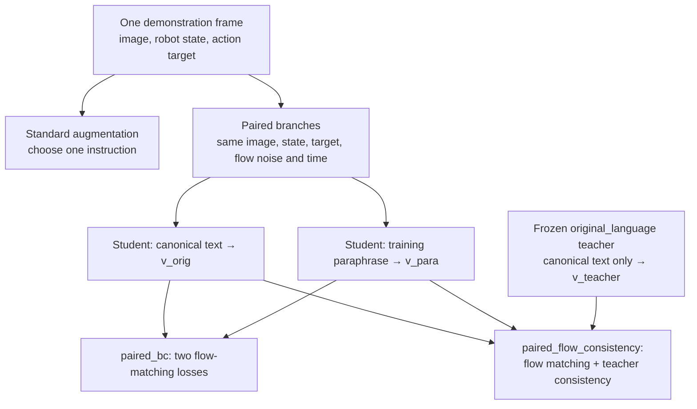

# Methods: language variation and paired flow training

This document describes the implemented intervention, its control, and its result. It is an experiment on the existing SmolVLA action expert, **not an architecture change or a successful final robustness method**. The key motivation was a [state-matched diagnostic](results.md#action-and-trajectory-diagnostics): equivalent text changed the first predicted action even when the physical observation was held fixed.

## Three training patterns



| Method | Language sampling | Physical and flow inputs per update | Extra signal |
| --- | --- | --- | --- |
| `augmented_language` | Canonical or one of four training paraphrases | One training branch | None |
| `paired_bc` | Canonical **and** one paraphrase | Exactly shared image, robot state, action target, Gaussian flow noise and flow time | None |
| `paired_flow_consistency` | Same two student branches | Same deterministic per-update controls as `paired_bc` | Frozen canonical teacher prediction |

`anchored_language` is a sampling ablation of ordinary augmentation: canonical language has 50% probability, while the four training paraphrases each have 12.5%. It failed its development selection gate.

## Paired flow-matching control

The two paired arms initialize their students from the **same frozen `original_language` step-1000 checkpoint**. Each receives exactly 1,000 optimizer updates. At update `k`, a frozen schedule selects one `(episode_index, frame_index)` and one of four training paraphrase IDs. Every paraphrase occurs exactly 250 times. Both arms use the same optimizer, LR schedule, trainable student tensors, batch size 1, BF16 autocast with FP32 trainable parameters, and checkpoints at updates 500 and 1,000. The paired arm configuration is [here](../configs/paired_training.json).

A dedicated per-update RNG stream derives the flow-matching Gaussian noise and time from the training seed and update index. This prevents teacher forward passes, logging or checkpointing from changing the student sample stream. The two training logs were compared step by step; the [control audit](../results/paired_training/paired_control_audit.json) records the match. The [frozen schedule copy](../results/paired_training/schedule.json) makes the selected frames and paraphrases auditable.

For action target `a` and sampled noise `ε`, the flow target is `uₜ = ε − a`. Both student branches see the same `a`, `ε` and flow time `t`; only their instruction tokens differ. The project-local [velocity helper](../src/smolvla_grounding/flow_velocity.py) exposes SmolVLA's predicted velocity `vₜ` for this controlled comparison.

### Paired BC

```text
L_paired_bc = ½ [ MSE(v_orig, uₜ) + MSE(v_para, uₜ) ]
```

This is the data/update-matched control. It trains both wordings against the same target without a teacher penalty.

### Paired flow consistency

A teacher is loaded from that same frozen source checkpoint, kept in evaluation mode with all parameters frozen, and given the **canonical** instruction only. Its forward pass has no gradient accumulation and its parameters are outside the optimizer.

```text
L_FM   = ½ [ MSE(v_orig, uₜ) + MSE(v_para, uₜ) ]
L_cons = ½ [ MSE(v_orig, stop_gradient(v_teacher))
           + MSE(v_para, stop_gradient(v_teacher)) ]
L_total = L_FM + 1.0 × L_cons
```

The consistency weight was frozen at **λ = 1.0**, not tuned after outcomes were seen. [Implementation](../src/smolvla_grounding/flow_velocity.py) and [training entry point](../scripts/run_paired_training.py).

## Selection and limit

Development evaluation used States 23–32 and two development-only paraphrases. `paired_bc` obtained O=1.00, P=0.60, H=0.7500; `paired_flow_consistency` obtained O=0.90, P=0.55, H=0.6828. The frozen consistency gate required H to exceed both 0.5538 and `paired_bc`'s H. It failed, so only `paired_bc` advanced with the two earlier baselines.

On the final v4 prompts, `paired_bc` achieved higher canonical success but **did not improve pooled unseen-paraphrase success**. The method is useful here as a controlled test of the diagnosis and of development-to-final generalization, not as a demonstrated solution. [Complete outcome tables and intervals](results.md).
