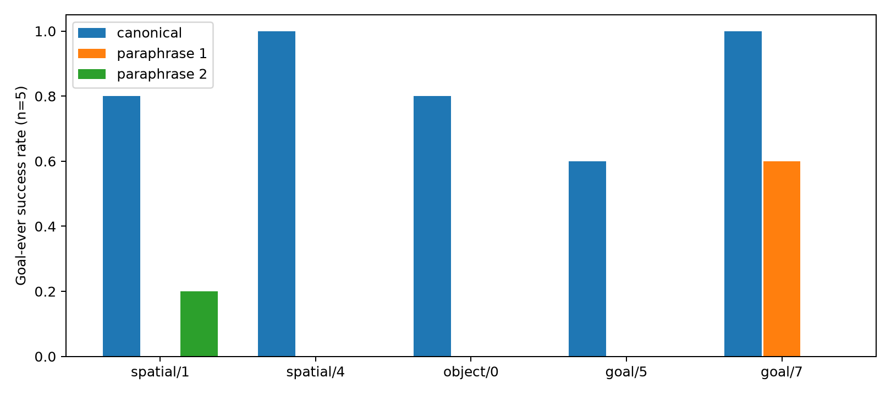
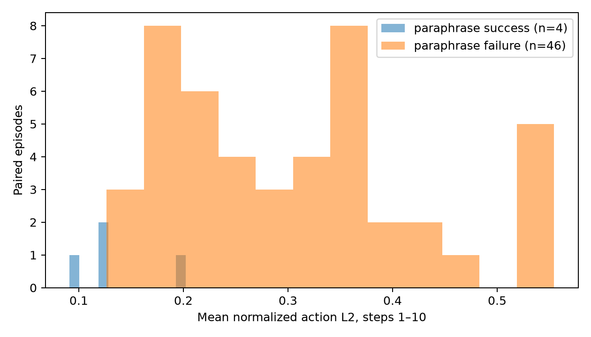
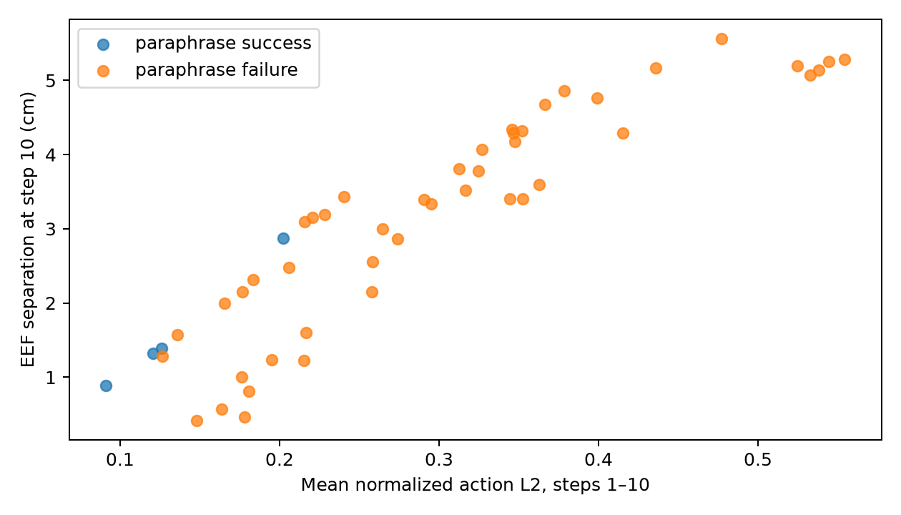
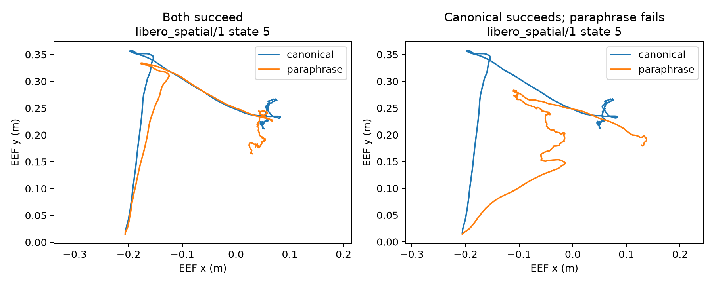

# Multi-task language sensitivity development pilot

## Frozen design

- Model: `untuned_fp32` only; no training.
- Eligible tasks: `libero_spatial/1`, `libero_spatial/4`, `libero_object/0`, `libero_goal/5`, `libero_goal/7`. `libero_goal/0` failed the 3/5 canonical competence gate.
- States: 5–9 for every task. States 30–49 are reserved and excluded.
- Each task/state uses its canonical instruction and the two fixed paraphrases below: 5 × 5 × 3 = 75 rollouts.
- Worker 1; environment/policy seeds 0; official LeRobot pipeline; 280 steps for spatial/object and 300 for goal; `goal_ever` is primary.
- All text and SHA256 values were frozen before any pilot rollout. The review below is project-author semantic review, not independent human validation.

## Frozen instruction catalog and semantic review

| Task | ID | Exact UTF-8 text | SHA256 | Semantic review |
| --- | --- | --- | --- | --- |
| `libero_spatial:1` | `original` | pick up the black bowl next to the ramekin and place it on the plate | `62903ee73ba3e6e73ed6183c529a34bf1cca052a1152e9fa6e60954b1eb7c5f3` | Keeps the black bowl adjacent to the ramekin as the target and the plate as destination. |
| `libero_spatial:1` | `paraphrase_01` | place on the plate the black bowl that is beside the ramekin | `7c4719a176a581ccf9933766b11efc6f8542fa7c62e9830a1a997361ab9ceb60` | Keeps the black bowl adjacent to the ramekin as the target and the plate as destination. |
| `libero_spatial:1` | `paraphrase_02` | take the black bowl positioned next to the ramekin, then set it on the plate | `4691692916ec3adb84b244f44c6388d79871203b667b524b287235b724ad8afc` | Keeps the black bowl adjacent to the ramekin as the target and the plate as destination. |
| `libero_spatial:4` | `original` | pick up the black bowl in the top drawer of the wooden cabinet and place it on the plate | `98fef9381e261cbac30d4c58daa38fda85460c0bf0d4dd838997f741be85c3fd` | Keeps the black bowl inside the wooden cabinet top drawer and the plate as destination. |
| `libero_spatial:4` | `paraphrase_01` | from the wooden cabinet's top drawer, take the black bowl and put it on the plate | `6ea71d3820527f11fdac0ce3bde5ea41c9ed52b58ac09109d6826d13af6af05e` | Keeps the black bowl inside the wooden cabinet top drawer and the plate as destination. |
| `libero_spatial:4` | `paraphrase_02` | place the black bowl located in the top drawer of the wooden cabinet onto the plate | `4af551d231721cde809439c9472025835196b8144355fdb7145448233a465f20` | Keeps the black bowl inside the wooden cabinet top drawer and the plate as destination. |
| `libero_object:0` | `original` | pick up the alphabet soup and place it in the basket | `2d112bee564a0f6cef3403df144f91ee5c02aebe0ad96c18d47e430c2734cb54` | Keeps alphabet soup as the picked-up object and the basket as destination. |
| `libero_object:0` | `paraphrase_01` | lift the alphabet soup and put it inside the basket | `339b3130b68ec1edd57d77250eabf5369de8a8b86d56e4d632352698782b1458` | Keeps alphabet soup as the picked-up object and the basket as destination. |
| `libero_object:0` | `paraphrase_02` | place the alphabet soup in the basket after picking it up | `be088f3610755f26af010a7fa22cd36407ba394db86611745258b28e90befe63` | Keeps alphabet soup as the picked-up object and the basket as destination. |
| `libero_goal:5` | `original` | push the plate to the front of the stove | `e1bde17bec614bc5b4d0b217384eb05f91d2f1309e1822c4a72d691016a4f4aa` | Keeps pushing the plate to the front of the stove. |
| `libero_goal:5` | `paraphrase_01` | move the plate by pushing it to the front of the stove | `6663dde9e91d84456b2158b7785624ea520a753614a93a5f37001b8be2b91b9f` | Keeps pushing the plate to the front of the stove. |
| `libero_goal:5` | `paraphrase_02` | to the front of the stove, push the plate | `9de9b208838ee1c73fb60e629a81f6ce8bd90855810ae2e1c293397d2ff190da` | Keeps pushing the plate to the front of the stove. |
| `libero_goal:7` | `original` | turn on the stove | `c0d1b2f3264d13ceb9741ea5987ec2dc542ca096e0fc21573fe1b6faf2e01e31` | Keeps the goal of switching the stove on; the passive variant states the desired outcome. |
| `libero_goal:7` | `paraphrase_01` | switch the stove on | `24ee8bda0ad20f2fa1c287e4e0502665d674ceab5aeb2b6e92d1542369d12c34` | Keeps the goal of switching the stove on; the passive variant states the desired outcome. |
| `libero_goal:7` | `paraphrase_02` | the stove should be turned on | `5493b4e935632c5740dc4b8b9bf8ece5fe1ae48f6e9116130a94ab144ca1d41c` | Keeps the goal of switching the stove on; the passive variant states the desired outcome. |

Each task has one canonical sentence and two meaning-preserving variants. The variants vary word order, voice, or action wording while retaining the official referent and goal. No pilot result was used to select them. For short Goal/7, syntactic variation is necessarily limited.

## Pairing and interpretation rules

- The official initial-state asset and row index are hashed in the manifest. A completed three-prompt group must have identical captured initial observation/simulator hashes and identical Step-1 RNG-state and sampled flow-noise hashes; otherwise execution stops.
- Actual Step-1 Gaussian noise is hash-compared across prompts. Later random streams may differ after closed-loop observations and policy paths diverge.
- Action dimensions are normalized by `max(P95−P5, 0.05)` measured on all 30 canonical competence-screen trajectories (states 0–4), fixed by analysis code before pilot outcomes.
- Report every task, every prompt, and all 50 canonical/paraphrase pairs. Compare Step-1 and steps 1–10 action differences, synchronized EEF displacement, and descriptive success associations.
- EEF/action traces alone do not establish object contact or failure phase. Unsupported classifications are `unknown`. Trajectory differences after feedback are not a controlled language-only effect.
- Five states per task make all outcome contrasts descriptive; no post hoc significance threshold is used.

## Reproduction artifacts

- Frozen matrix: `configs/multitask_evaluation/language_pilot_matrix.json`.
- Frozen hash manifest: `configs/multitask_evaluation/language_pilot_manifest.json`.
- Raw local rollouts, videos, trajectories, and logs: `outputs/multitask_evaluation/runs/multitask_language_sensitivity_pilot/` (Git-ignored).
- Run entry: `scripts/run_multitask_language_pilot.py`. Analysis: `scripts/analyze_multitask_language_pilot.py`. Curated results and four reproducible figures are in results/multitask_language_pilot/.

## Completed pilot: integrity and success

The production preflight accepted exactly 75 matrix cells before execution. One serial WSL process completed 75/75 valid complete.json commits; the post-run analyzer independently revalidated the committed artifacts and raw-file hashes. No final-test state (30–49), new training, or Task-0 frozen protocol was used. All three prompts for each task/state shared the hashed initial observation and simulator state. The recorded Step-1 RNG state and sampled flow noise matched within every three-prompt group; all 50 canonical/paraphrase pairs also matched flow noise at the first 10 synchronized steps. This does not make subsequent observations or random streams identical after trajectories diverge.

Primary metric: goal_ever. The table reports canonical success minus pooled paraphrase success (O−P), in percentage points. The machine-readable paired_difference retains its original P−O sign; pooled treats the two paraphrases equally. A canonical-success/paraphrase-failure count is over 10 prompt pairs per task, not five unique states.

| Task | Canonical | Paraphrase 01 | Paraphrase 02 | Pooled paraphrases | Canonical − pooled (O−P) | Canonical-success / paraphrase-failure pairs |
| --- | ---: | ---: | ---: | ---: | ---: | ---: |
| spatial/1 | 4/5 (80%) | 0/5 (0%) | 1/5 (20%) | 1/10 (10%) | +70 pp | 7/10 |
| spatial/4 | 5/5 (100%) | 0/5 (0%) | 0/5 (0%) | 0/10 (0%) | +100 pp | 10/10 |
| object/0 | 4/5 (80%) | 0/5 (0%) | 0/5 (0%) | 0/10 (0%) | +80 pp | 8/10 |
| goal/5 | 3/5 (60%) | 0/5 (0%) | 0/5 (0%) | 0/10 (0%) | +60 pp | 6/10 |
| goal/7 | 5/5 (100%) | 3/5 (60%) | 0/5 (0%) | 3/10 (30%) | +70 pp | 7/10 |
| **All five** | **21/25 (84%)** | **3/25 (12%)** | **1/25 (4%)** | **4/50 (8%)** | **+76 pp** | **38/50** |

The secondary goal_final counts equal goal_ever for every prompt in this pilot: per-task canonical / paraphrase_01 / paraphrase_02 counts are spatial/1 4/0/1, spatial/4 5/0/0, object/0 4/0/0, goal/5 3/0/0, and goal/7 5/3/0 (each over five states). Aggregate goal_final is 21/25 canonical and 4/50 pooled paraphrases. This equality is observed here; the metric definitions remain distinct.

The 50 matched outcome transitions are: both succeed **4**, canonical succeeds and paraphrase fails **38**, canonical fails and paraphrase succeeds **0**, both fail **8**. The [per-rollout source table](../results/multitask_language_pilot/per_rollout.csv) preserves each model/task/state/prompt identity and both success metrics; the [pair table](../results/multitask_language_pilot/pair_level.csv) preserves transition labels.

Across the 25 task/state clusters, 21 had canonical success and at least one paraphrase failure (spatial/1: 4; spatial/4: 5; object/0: 4; goal/5: 3; goal/7: 5). All four paraphrase successes occurred where canonical also succeeded; there were no reverse discordances. The largest observed pooled drop was spatial/4 (100 pp, O−P). The small sample and two fixed wordings per task do not establish a task-level ranking beyond this pilot.

## Action and trajectory diagnosis

All 50 paired Step-1 action-vector L2 differences were nonzero (range 0.069–0.517 in raw action units). The action normalizer was fixed from 30 canonical competence-screen trajectories on states 0–4: each dimension uses max(P95−P5, 0.05). Early divergence is mean normalized action L2 over synchronized steps 1–10. EEF separation compares positions at the same step; after Step 1 it includes closed-loop feedback and physical-state divergence.

| Task | Mean Step-1 raw action L2 | Mean Step-1 normalized L2 | Mean steps 1–10 normalized L2 | Mean EEF separation at Step 10 |
| --- | ---: | ---: | ---: | ---: |
| spatial/1 | 0.41 | 0.37 | 0.38 | 4.17 cm |
| spatial/4 | 0.18 | 0.16 | 0.28 | 3.00 cm |
| object/0 | 0.15 | 0.16 | 0.26 | 2.39 cm |
| goal/5 | 0.20 | 0.21 | 0.31 | 3.25 cm |
| goal/7 | 0.16 | 0.15 | 0.22 | 2.55 cm |

Across all 50 pairs, mean normalized Step-1 action L2 was **0.210** and mean Step-1 EEF separation was **1.14 mm**. Mean normalized action L2 over Steps 1–10 was **0.289**; mean EEF separation at Step 10 was **3.07 cm**. All 50 pairs have complete Step-1 and early EEF/action coverage; no missing EEF value was imputed as zero.

The four successful paraphrase pairs averaged 0.135 early normalized action L2 and 1.62 cm EEF separation at Step 10; the 46 failed pairs averaged 0.302 and 3.20 cm. These are descriptive associations with only four successful paraphrases, uneven task composition, and overlapping early-divergence ranges (success 0.091–0.202; failure 0.127–0.554). For example, goal/7 state 6 paraphrase_01 failed at 0.127, close to successful pairs. Early divergence therefore does not by itself explain or predict every failure. Identical initial states and matched early noise support a language-conditioned Step-1 action difference; later trajectory separation cannot be attributed to language alone.

## Failure-stage review and interpretation

Twelve deterministic, publicly inspectable comparisons (10 failures and two success contrasts) are documented in the [case analysis](multitask_failure_cases.md), with [case index and exact prompt texts](../results/multitask_language_pilot/case_index.csv) and hashed keyframe sheets. The committed simulator-state arrays and action/EEF traces contain no labeled contact or task-phase events. We inspected sampled frames spanning all 75 front-view videos together with their trajectories. The views show that many spatial/4 failures approached the cabinet without a visible bowl transfer, object/0 failures often left the soup can at its starting area, goal/5 failures did not put the plate at the required stove-front location, and goal/7 failures left the stove visibly off. These observations describe unmet task goals; they do not reliably separate approach, initial contact, manipulation, and final placement or activation for each episode. The machine-readable precise failure-stage field is therefore unknown for all 50 failed rollouts. In particular, the push and stove-switch tasks should not be labeled as grasp failures. No contact-mechanism claim is made from sparse frames.

This development pilot reproduces the qualitative Task-0 phenomenon across five additional tasks: under matched initial physical states and early noise, semantically reviewed wording changes the first predicted action and is accompanied by large observed success drops. It is evidence for investigating language-conditioning alignment as a next technical direction, but insufficient to conclude an Adapter will help. Counterevidence and alternatives include canonical failures (especially goal/5), heterogeneous prompts and task semantics, overlap between successful and failed divergence magnitudes, and only five states per task. Additional controlled evidence would be needed before treating early divergence as the cause of failure; no Adapter was trained here.

## Reproduction and scope

The complete local experiment is under outputs/multitask_evaluation/runs/multitask_language_sensitivity_pilot/. Raw execution and analysis logs are outputs/multitask_evaluation/language_pilot_execution.log and outputs/multitask_evaluation/language_pilot_analysis.log. The checked-in 75-row per_rollout.csv, 50-row pair_level.csv, summary.json, integrity.json, compact EEF examples, and four quantitative PNGs in results/multitask_language_pilot/ are regenerated by scripts/analyze_multitask_language_pilot.py from committed local rollouts. The production runner scripts/run_multitask_language_pilot.py safely skips valid complete.json cells and reports progress. Large videos, trajectories, model weights, and caches remain local and Git-ignored.

The [integrity audit](../results/multitask_language_pilot/integrity.json) records 75 valid commits, 75 attempt directories, zero incomplete attempts, all 25 pairing groups, frozen resource hashes, and hashes of the public input tables and four figures. From the project WSL environment with local model/simulator assets, run:

~~~bash
.venv/bin/python scripts/analyze_multitask_language_pilot.py
.venv/bin/python scripts/export_multitask_failure_cases.py
~~~

To independently verify the published 75-row and 50-row tables, frozen prompt catalogs, all statistics, four figure hashes, and 12 case-sheet hashes **without raw videos, weights, or a GPU**, use a Python environment with NumPy and Matplotlib:

~~~bash
python scripts/regenerate_multitask_language_pilot.py
~~~

The public verifier renders plots in a temporary directory and compares bytes to the checked-in PNG hashes; cross-platform font or Matplotlib differences may require the recorded environment versions. It verifies consistency of the published source tables, not their truth against unavailable raw simulator files. The raw analyzer performs the stronger local commit, artifact-hash, model, state-asset and pairing checks.

This is a development diagnostic, not a confirmatory cross-task benchmark or a claim of statistical significance.
