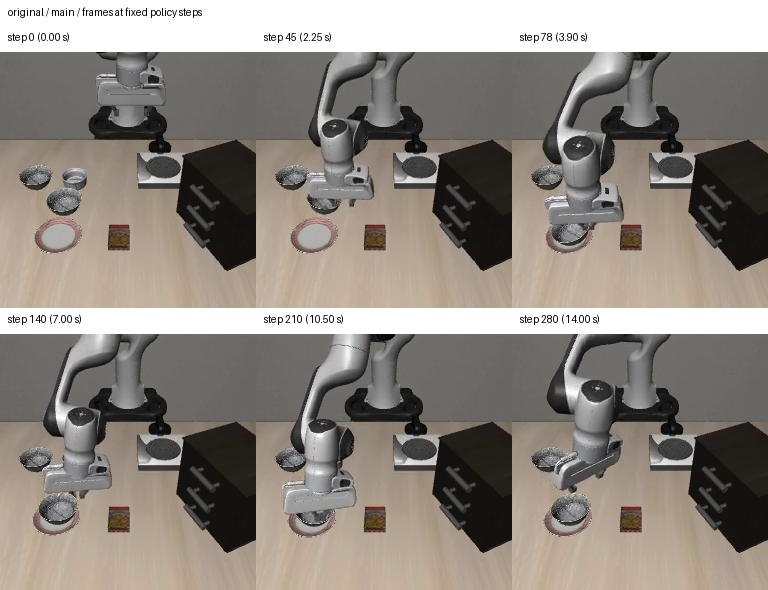
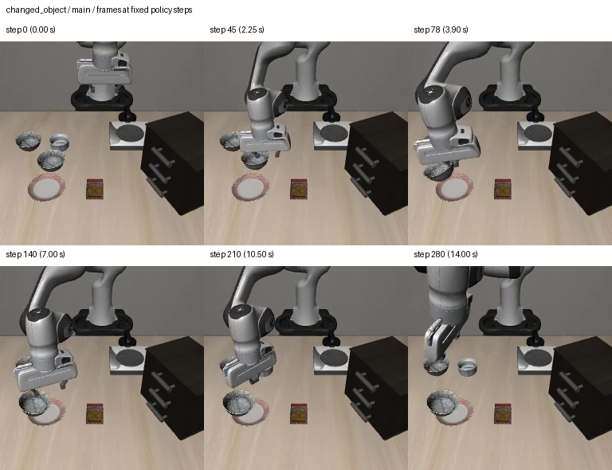

# Task-0 language pilot: measured outcomes and open controls

All six fixed-horizon episodes completed. The saved completion markers, artifact
hashes, action logs, simulator-state arrays, goal summaries and all twelve videos
were checked by `scripts/analyze_language_pilot.py`. Initial state and RNG arrays
match across every condition. Each video decodes to 281 frames at 20 FPS.

This is one task, one official initial state (index 0), and one environment/policy
seed (0). There are no fine-tuning results or generalization estimates.
The protocol runs for 280 policy steps even after task success; it is distinct from
standard early-termination evaluation.

| Instruction | Requested goal ever achieved | Requested goal at final step | First achievement |
| --- | --- | --- | --- |
| Original | Yes | Yes | Step 78 |
| Identical original repeat | Yes | Yes | Step 78 |
| Paraphrase 01 | No | No | — |
| Paraphrase 02 | No | No | — |
| Changed spatial referent | No | No | — |
| Changed object to ramekin | No | No | — |

The main original condition is 1/1; its repeat is a separate diagnostic control.
The two paraphrase trials are 0/2. Changed-goal predicates were false throughout
both changed-instruction trials; their positive-case validation remains pending.
Do not turn these dependent single-scene observations into a general success-rate
estimate or claim that the policy correctly follows semantic changes.

Data: [episode CSV](summary.csv), [episode JSON](summary.json), [integrity and repeat audit](audit.json).
Video/array paths in the JSON are relative to local `outputs/language_pilot/`.
Audit frame-sheet paths refer to local `outputs/language_pilot_review/`. Full videos
remain local; selected small frame sheets are included below.

## Identical-original control

The repeated original has exactly matching saved initial arrays and RNG states.
Its first 45 action vectors and simulator states through step 45 are bitwise equal
to the original. The first differing action occurs at step 46, with maximum absolute
component difference 0.00216826797. The largest component difference later in the
episode is 2.05922008, at step 197. This mixes action components with different
physical meanings and is not a calibrated physical-distance metric.

Both originals first satisfy the goal at step 78 and finish successfully. Their
original-goal flags differ at 13 intermediate steps: 79, 83, 118, 144, 149, 152, 156,
159, 219, 220, 222, 223 and 224. Thus unequal goal timelines do not mean conflicting
episode success in this pair. Continuing beyond initial success exposes fluctuations
that standard early termination would not retain.

The cause is unresolved. Per-step policy input tensors, RNG states and sampled flow
noise were not saved. Equal captured physics states do not establish equal images or
hidden controller/observable state; lossy decoded video cannot certify raw pixel
identity. Numerical/kernel variability is another candidate. Deterministic algorithms
were disabled in the saved runtime settings, but this alone does not establish the
cause. Do not silently change precision/backend flags and overwrite this run.

All four altered instructions already change the first action, while the repeated
original has an identical first action. This is consistent with language affecting
the policy's output; it does not establish correct semantic grounding or isolate
the cause of the later success differences.

## Initial qualitative findings

Review basis: fixed-time main-camera frames at steps 0, 45, 78, 140, 210 and 280
for all six conditions; wrist frames for paraphrase 02 and changed object; and
per-step object-position logs. This is an assistant inspection, not independent or
exhaustive human annotation of every video frame. Causal labels remain provisional.

| Trial | Observed evidence | Provisional interpretation |
| --- | --- | --- |
| Paraphrase 01 | Target bowl rises at most 0.0038 m relative to step 1; goal never true | No substantial target lift; possible grasp/control failure |
| Paraphrase 02 | Target bowl rises up to 0.0728 m but ends 0.1659 m horizontally from plate center | Object lifted without successful target placement; cause unresolved |
| Changed relation | Other bowl rises at most 0.0145 m; requested goal never true | No successful other-bowl transfer; wording ambiguity remains a limitation |
| Changed object | Original black bowl rises up to 0.1190 m; ramekin has no upward displacement at four-decimal precision | Wrong-object manipulation under the ramekin instruction |

Displacements use simulator body positions. Maximum upward displacement is
`max(z_t - z_1)` over policy steps `t = 1, ..., 280`; final horizontal distance is the XY Euclidean distance between object
and plate body centers at step 280. These descriptive measures do not replace the
official `on` predicate or prove grasp contact.

The changed-object trial ends with the black bowl about 0.0474 m horizontally from
the plate center. LIBERO's `on` predicate is false, so visible proximity to the plate
is not scored as success. Positive alternative-goal checks remain unvalidated.

Original instruction:



Changed-object instruction, requesting the ramekin:



[Changed-object wrist view](changed_object_wrist_frames.png) and
[paraphrase-02 main view](paraphrase_02_frames.png) provide additional context.

## Resources and reproduction

The six upstream rollout timers sum to 1,272.66 s (21.21 min). Peak PyTorch reserved
memory reported by each trial is 1,327,497,216 bytes (about 1.24 GiB), excluding
non-PyTorch renderer allocations. GNU time recorded 2:35:18 for the whole invocation
and 4,547,664 KiB peak RSS (about 4.34 GiB). The substantial time outside the rollout
timers is unresolved; do not report 21.21 minutes as total command runtime or
attribute all of the extra time to imports without stage timing evidence.

To audit saved artifacts and regenerate frame sheets in the validated WSL environment:

```bash
python scripts/analyze_language_pilot.py
```

This only reads existing episodes. Repeated extraction asks interactively to reuse
verified completed work and preserves incomplete attempts. It does not run a policy.
The original evaluation command remains `bash scripts/run_language_pilot.sh`.

## Next acceptance gate

Before expansion or fine-tuning, instrument a separate repeated-original diagnostic
to retain preprocessed policy-input hashes, pre-inference RNG/noise evidence and
normalized actions around the first divergence. Repeated inference on the same
recorded input/noise can then separate policy variability from observation/control
variability. Preserve the current run as the measured pilot. The separate
[completed diagnostic](../repeat_diagnostic/README.md) localizes the first input
difference to four background pixels and reproduces each recorded action on replay.
The exact rendering cause is unresolved; retain repeated-original outcome controls
while expanding the baseline.

After diagnosing the control, validate positive alternative-goal cases and expand
to multiple initial states and policy seeds with the same protocol. Only then select
the adaptation budget and compare equal-budget original-language versus augmented
fine-tuning.
