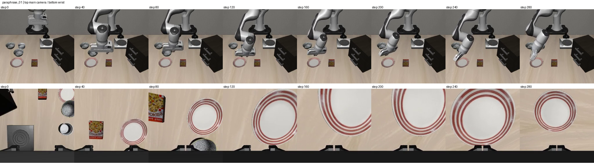
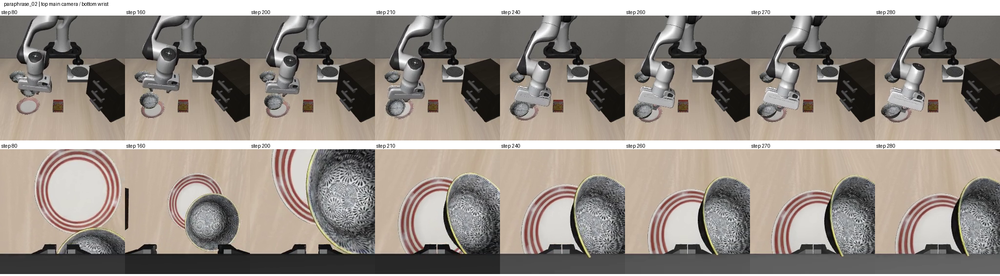

# Lower-learning-rate development results

Both 200-update arms used a 1e-5 peak learning rate, with the same sampled frames,
language assignments and initial weights/RNG controls as the first 1e-4 run.
Evaluation completed 24 new episodes and reused 12 hash-verified untuned episodes.
The comparison was recomputed from its episode records; both new model-load reports
passed parameter-byte and original-normalization checks.

Counts below are **goal-ever / goal-at-final-step**, each out of three initial states:

| Model | Original A | Paraphrase B | Paraphrase C |
| --- | --- | --- | --- |
| Untuned, reused baseline | 1/3 / 1/3 | 0/3 / 0/3 | 0/3 / 0/3 |
| Original-language tuning, 1e-5 | 1/3 / 1/3 | 0/3 / 0/3 | 0/3 / 0/3 |
| Language-augmented tuning, 1e-5 | 3/3 / 3/3 | 0/3 / 0/3 | 1/3 / 0/3 |

Original-repeat ever/final disagreements were zero for every model; repeats are
excluded from the main counts above. The original-language arm restored its state-0
original success, which had failed at the higher learning rate. The augmented arm
completed A in all three states, compared with one at the higher rate and one in
the untuned baseline. See the [first round](../adaptation_development/README.md).

The augmented C/state-0 episode satisfied the native original-goal predicate at
steps 206, 208 and 210–270, inclusive (63 recorded steps total), then lost it for
steps 271–280. Thus it is a goal-ever success but a final-step failure. The log does
not itself establish whether the bowl slipped, was displaced, or another contact
caused this loss. Selected dual-camera frames and complete position logs have now
been reviewed for augmented B/C at state 0. B has only 2.5 mm of target height rise
and no transfer. During C's late goal-true interval, the arm and bowl/plate keep
moving. A specific contact mechanism has not been verified. We do not describe this as
stable completion or convert it into a standard early-stopping LIBERO score.

The clearest observed gain is on the original wording; general paraphrase robustness
has not been established. B still fails all three cases, and neither paraphrase has
a final-step success. These are one-task development results, using states 0/1/2,
policy seed 0 and 280-step fixed horizons. Learning rate was changed after reviewing
the first round, so this is development model selection, not an untouched test or
statistical evidence across independent tasks. Reused baseline episodes must not be
counted as new observations.

[CSV](summary.csv) and [JSON](summary.json) retain counts, paired cases and the
transient-success timeline. Raw outputs remain in
`outputs/adaptation_evaluation/runs/task0_lower_lr_eval/`. The next
[longer low-learning-rate experiment](../../docs/training_budget.md) is prepared.
Both positive and negative development results are retained.

Selected state-0 examples (top row main camera, bottom row wrist camera):

[Annotations and source hashes](qualitative_review.json) document the selected
frames. These are assistant-authored observations, not independent human labels
or a representative failure-frequency estimate.
