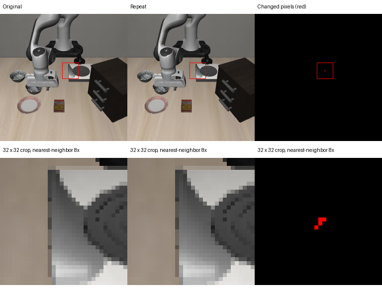

# Repeated-original diagnostic: four background pixels at the first divergence

The repeated-original diagnostic completed both 280-step trials. Both first satisfy
the original goal at step 78 and remain successful at the final step. At prediction
46, their only differing recorded policy-input tensor is the primary camera image.
All four recorded-input replays reproduce their corresponding recorded actions.

Evidence: [diagnostic and replay JSON](diagnostic.json), [pixel/state audit](pixel_review.json),
[exact changed-pixel CSV](pixels.csv). The original run and its archives remain local
and unchanged. Paths inside the pixel report refer to `outputs/repeat_pixel_review/`.

## What differs

| Input/control at prediction 46 | Observed comparison |
| --- | --- |
| Primary camera, 256 × 256 | 4 changed pixels out of 65,536; 12 RGB channel values |
| Channel difference | Repeat is exactly +1 on the 0–255 scale at each changed channel |
| Wrist camera | Exactly equal |
| Language tokens and attention mask | Exactly equal |
| Processed robot state | Exactly equal |
| RNG before/after inference and sampled noise | Equal throughout both recorded trials |
| Previous 45 applied actions | Exactly equal |
| Saved simulator states through action 45 | Exactly equal |

Prediction 46 consumes the observation **after action 45**, before applying action
46. This avoids attributing an image difference to the action it precedes.
The changed coordinates below use zero-based policy-image `(x, y)` coordinates:

| Pixel | Original RGB | Repeat RGB |
| --- | --- | --- |
| (141, 113) | (93, 93, 93) | (94, 94, 94) |
| (142, 113) | (90, 90, 90) | (91, 91, 91) |
| (141, 114) | (99, 99, 99) | (100, 100, 100) |
| (140, 115) | (106, 106, 106) | (107, 107, 107) |

They occupy about 0.0061% of the image, in the background near the stove. The figure
shows original pixels without brightness amplification, and a binary red difference
mask. The lower row is a 32 × 32 crop enlarged 8× using nearest-neighbor sampling.



## Evidence chain and limits

The saved tensors are lossless compressed byte records, not decoded MP4 frames.
The inspector verifies tensor hashes and exactly reverses the upstream uint8-to-float
scaling. It then undoes the installed `LiberoProcessorStep` 180-degree rotation and
verifies the recovered uint8 arrays against the raw-camera hashes recorded before
policy processing. This places the difference before language/normalization processing.

For each of the two recorded inputs at prediction 46, two replays restore the same
RNG and start with empty policy action queues. Input, RNG, sampled noise and action
all match the respective recording. Thus the different action values reproduce with
this four-pixel input difference. The evidence does not support attributing this
event to differing sampling noise or an irreproducible output for an identical input.

Tiny rendering/derived-observation variation is consistent with the findings. Its
precise low-level origin is still unproven: flattened simulator state does not cover
every derived renderer/controller state. No EGL, MuJoCo or CUDA bug is established,
and two replays do not prove universal model determinism. Tracing may also affect
timing. The perturbation was naturally observed, not adversarially constructed.

The two originals still succeed, so this event is not evidence that four pixels cause
a success-rate drop. The single-state paraphrase failures remain preliminary, and
the noise control must be retained when expanding the language comparison.

## Reproduce the saved-data inspection

```bash
python scripts/inspect_repeat_pixels.py
```

This uses NumPy and Pillow, verifies existing artifacts, and inspects the recorded
first differing input without loading Torch or running the simulator. It has
per-camera checkpoints and an interactive continuation prompt. Source diagnostic
archives remain under `outputs/repeat_diagnostic/`; new output is under
`outputs/repeat_pixel_review/`.

Twenty CPU code checks passed, including signed pixel subtraction, channel/pixel
counts and the rotation/hash round trip. The inspector also passed on the actual
recordings. Runtime trace sizes were 84,945,656 and 86,386,697 bytes (about 81.0 and
82.4 MiB); their sum is about 163.4 MiB. Both trial PyTorch reserved peaks remain
1,327,497,216 bytes. These figures exclude non-PyTorch renderer allocations.

## Decision for the next benchmark

Close this diagnostic as a localized observation-side perturbation, with low-level
cause unresolved. Preserve the official renderer, precision and controller settings;
do not blur, quantize or filter images to conceal the difference.

Next, expand the same six conditions across several official initial states, retain
an identical-original repeat within every state/seed group, and check initial state
and policy-RNG pairing as before. Record original-repeat disagreements in episode
outcomes separately from trajectory equality. Start with a small measured batch,
then add policy seeds before estimating robustness or training improvements.

The batch size/state budget should be selected interactively in the next runner and
saved before execution. Positive alternative-goal validation remains required before
interpreting changed-goal rates. Fine-tuning is still pending the broader baseline.

The [interactive multi-state runner](../../docs/state_benchmark.md) is now implemented
and awaiting GPU acceptance. Its default budget is 18 episodes; no multi-state
measurements are claimed yet.
